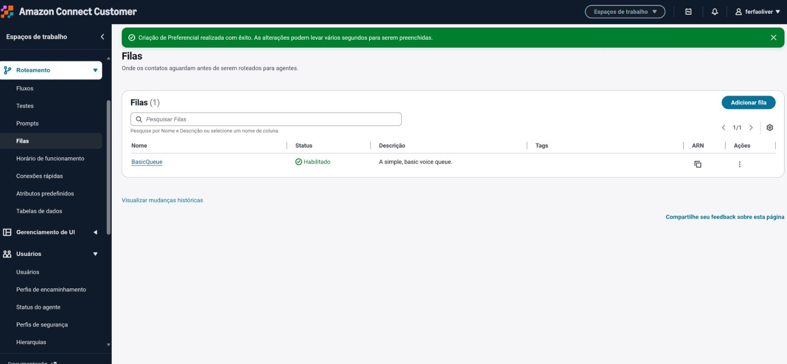
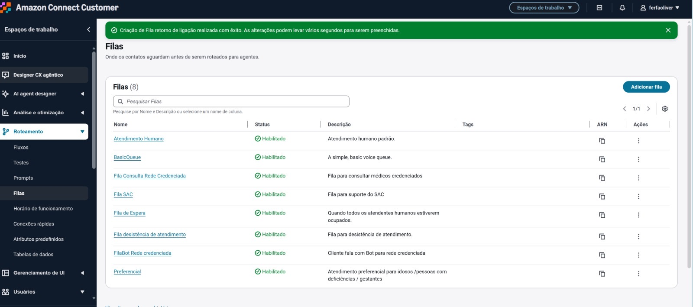
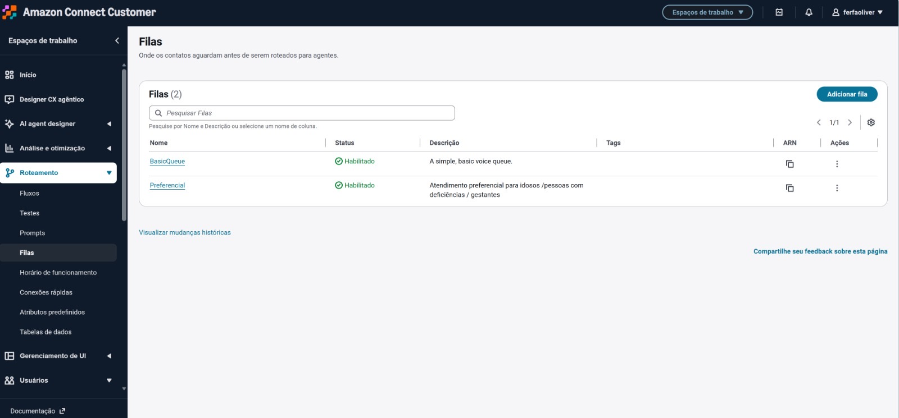
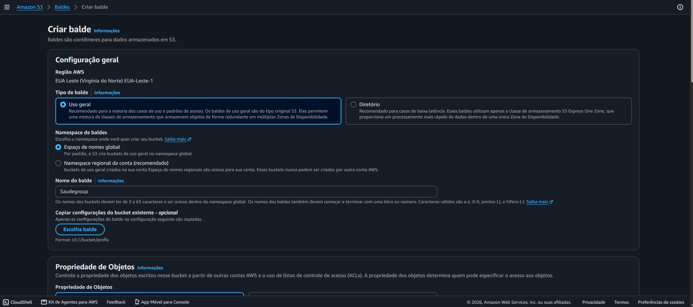
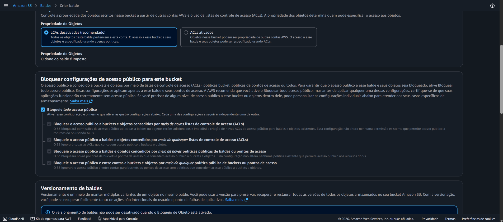
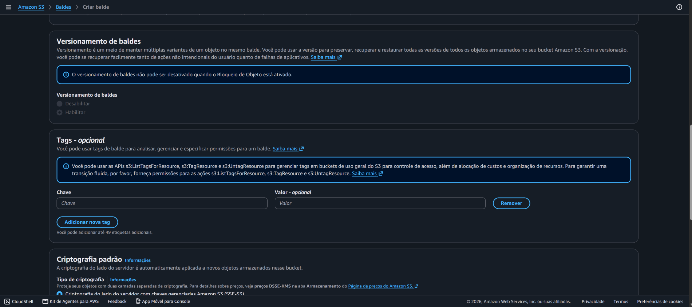
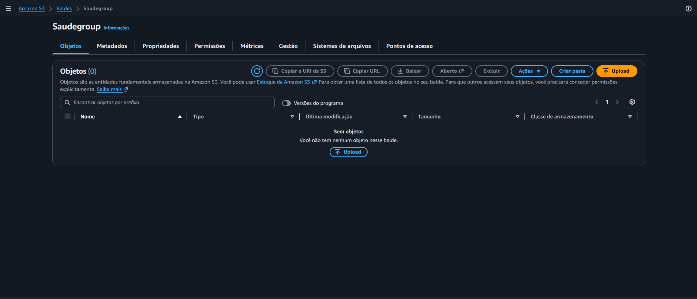

# Atendimento de saúde com Amazon Connect

Documentação ilustrada de um protótipo de atendimento telefônico para ajudar clientes a localizar médicos de uma rede fictícia por região e especialidade no estado de São Paulo.

> **Aviso:** os nomes, endereços, CEPs e telefones da base são fictícios e servem somente para demonstração. Não representam profissionais ou uma rede credenciada real. Não use os dados para atendimento ou contato.

## Como funciona a experiência

1. O cliente inicia uma chamada no Amazon Connect.
2. O fluxo recebe a solicitação e conversa com o bot Lex.
3. O bot identifica a região de São Paulo e a especialidade desejadas.
4. A consulta ao diretório retorna opções de médicos daquela combinação.
5. O fluxo pode informar os dados ou encaminhar o cliente para uma fila de atendimento humano.

As capturas registram telas de configuração do Amazon Lex, do fluxo do Connect, de filas, do S3 e de componentes AWS relacionados. Elas documentam as etapas de configuração; a integração em execução deve ser validada na própria conta AWS.

## Passo a passo

### 1. Preparar a base de conhecimento

O diretório tem 20 especialidades, seis regiões e cinco médicos fictícios por combinação, totalizando 600 registros. O JSON contém os catálogos de regiões e especialidades, aliases para reconhecimento e a lista de médicos. O CSV oferece a mesma lista em formato tabular.

- [JSON estruturado](data/base_conhecimento_medicos_sp.json)
- [CSV de médicos](data/medicos_rede_ficticia_sp.csv)

### 2. Configurar o bot no Amazon Lex

Crie ou abra o bot e configure as intenções necessárias para identificar a região, a especialidade, a busca na rede e a solicitação de atendimento humano. Adicione enunciados de exemplo com nomes completos, abreviações e variações que clientes possam usar. Configure slots/valores para normalizar as respostas antes de consultar o diretório.


*Figura 1 — Visão de configuração do bot Lex e recursos associados ao projeto.*


*Figura 2 — Intenções configuradas para organizar os tipos de solicitação reconhecidos pelo bot.*


*Figura 3 — Edição de uma intenção e seus enunciados de exemplo.*


*Figura 4 — Aliases ajudam a mapear diferentes formas de falar para um mesmo valor reconhecido.*

### 3. Cadastrar regiões e especialidades

Use os mesmos identificadores normalizados no Lex, na Lambda e no JSON. As regiões presentes na base são `centro`, `oeste`, `sul`, `norte`, `leste` e `abc_grande_sp`. “Nutrição esportiva” aparece como frase de exemplo e está associada à especialidade Nutrição.


*Figura 5 — Exemplos de fala para localizar as regiões de São Paulo.*


*Figura 6 — Primeira parte da lista de especialidades configuradas na intenção de busca.*


*Figura 7 — Continuação da lista de especialidades disponíveis para reconhecimento.*


*Figura 8 — Mais exemplos de especialidades e termos equivalentes usados na intenção.*


*Figura 9 — Parte final da relação de especialidades e seus enunciados.*


*Figura 10 — Visão das intenções e exemplos de enunciados cadastrados.*


*Figura 11 — Formulário para adicionar uma intenção ao bot.*


*Figura 12 — Campos de configuração usados para coletar e validar informações da conversa.*


*Figura 13 — Visão geral do bot e de seus recursos configurados.*

### 4. Montar o fluxo de contato no Amazon Connect

No designer de fluxos, conecte a entrada da chamada à saudação, à coleta das informações e às decisões para busca ou atendimento humano. Trate caminhos de sucesso e erro, configure mensagens de retorno e encaminhe a chamada para a fila apropriada quando necessário.


*Figura 14 — Visão do fluxo de entrada, com blocos de voz, coleta de informações, consulta e transferência.*

### 5. Configurar fila e encaminhamento

Crie a fila de atendimento humano e associe-a às opções de roteamento e aos horários de funcionamento da operação. Revise o destino de transferência e o tratamento para fila sem agentes disponíveis.


*Figura 15 — Configuração de fila usada pelo caminho de atendimento humano.*

### 6. Armazenar os arquivos no Amazon S3

Crie um bucket na região AWS escolhida para o ambiente e envie o JSON (e, se útil para integração ou auditoria, o CSV). Mantenha o bucket privado e conceda acesso de leitura somente à função de integração que precisa consultar os objetos.



*Figura 16 — Área de armazenamento S3 usada para organizar os arquivos da base de conhecimento.*


*Figura 17 — Arquivo da base carregado no bucket S3.*

### 7. Integrar a consulta ao fluxo

Uma forma de fazer a busca determinística é chamar uma função AWS Lambda a partir do fluxo. A função recebe os identificadores normalizados da região e da especialidade, lê o JSON no S3, filtra os médicos que correspondem aos dois valores e devolve os campos necessários ao Connect. Configure a permissão `s3:GetObject` para o objeto usado e teste as respostas de sucesso, ausência de resultados e erro.



*Figura 18 — Lista de funções disponível na conta para componentes de integração.*



*Figura 19 — Outra captura da área de funções Lambda durante a configuração do protótipo.*

### 8. Associar o Lex ao Connect e validar

Associe o bot publicado ao fluxo, confira se os nomes de atributos e IDs usados nas intenções correspondem aos valores da base e percorra cada ramo pelo menos uma vez. Valide as seis regiões e as especialidades, além dos caminhos de fallback, erro e transferência. Os prints abaixo registram exemplos de configuração das intenções relacionadas ao atendimento.


*Figura 20 — Intenção de atendimento humano e enunciados associados.*

### 9. Referências de configuração do Amazon Bedrock

O ZIP também contém capturas de telas de configuração do Bedrock. Elas ficam documentadas em sequência para preservar o material de referência; use-as somente se a arquitetura do seu projeto realmente incluir recursos do Bedrock.



*Figura 21 — Tela de seleção/configuração de modelo no Bedrock.*



*Figura 22 — Configurações adicionais de modelo exibidas durante a preparação.*



*Figura 23 — Opções relacionadas à configuração de conhecimento no Bedrock.*


*Figura 24 — Tela de validação e revisão das opções selecionadas.*



*Figura 25 — Captura complementar do processo de configuração no Bedrock.*

## Estrutura do repositório

```text
.
├── README.md
├── data/
│   ├── base_conhecimento_medicos_sp.json
│   └── medicos_rede_ficticia_sp.csv
└── docs/
    └── images/
        ├── 01-...jpg
        └── ...
```

## Observações

- O Amazon S3 armazena os arquivos; a lógica de filtragem precisa ser feita por uma integração, por exemplo uma função Lambda.
- A Knowledge Base do Amazon Connect/Bedrock é voltada à recuperação de conteúdo e respostas generativas. Para localizar registros estruturados de forma determinística, use uma consulta apropriada aos campos normalizados.
- As telas podem variar conforme a versão do console AWS e a região da conta.
- Antes de qualquer uso real, substitua os dados fictícios por informações autorizadas e confirme credenciamento, contatos e endereços com a fonte oficial.
