# Atendimento de saúde com Amazon Connect

Documentação ilustrada de um protótipo de atendimento telefônico para ajudar clientes a localizar médicos de uma rede fictícia por região e especialidade no estado de São Paulo.

> **Status do projeto:** em andamento. O projeto ainda não foi finalizado. A consulta ao diretório por Lambda, as regras da fila preferencial, a análise de sentimentos e os testes ponta a ponta ainda precisam ser concluídos e validados.

> **Aviso:** a base de conhecimento armazenada no S3 foi criada com dados fictícios para demonstração: nomes, endereços, CEPs e telefones não representam profissionais ou uma rede credenciada real. Não use esses dados para atendimento ou contato.

## Como funciona a experiência

1. O cliente inicia uma chamada no Amazon Connect.
2. O fluxo recebe a solicitação e conversa com o bot Lex.
3. O bot identifica a região de São Paulo e a especialidade desejadas.
4. A consulta ao diretório retorna opções de médicos daquela combinação.
5. O fluxo pode informar os dados ou encaminhar o cliente para uma fila de atendimento humano.

As capturas registram telas de configuração do bot, do fluxo do Connect, de filas e do S3. Identificadores de conta, nomes de recursos e dados de usuário foram ocultados nas imagens destinadas a este repositório. As capturas documentam etapas de configuração; valide a integração em execução na sua conta AWS.

## IA com foco em um atendimento mais humanizado

O objetivo do projeto é usar IA para tornar o atendimento mais simples e acolhedor, sem deixar de oferecer acesso a uma pessoa quando a situação pedir conversa ou apoio humano.

### Conversa por voz, sem depender de digitação

Com um bot Amazon Lex ligado ao fluxo de voz do Amazon Connect, o cliente pode dizer naturalmente o que precisa — por exemplo, “quero encontrar um cardiologista na zona sul” — em vez de navegar por menus numéricos ou digitar em uma central tradicional. O bot pode confirmar o que entendeu, perguntar a informação que estiver faltando e encaminhar a solicitação ao fluxo. O Connect também permite configurar a voz e os prompts usados na conversa. [Integração de um bot Lex ao Connect](https://docs.aws.amazon.com/connect/latest/adminguide/amazon-lex.html) · [Bloco de entrada do cliente](https://docs.aws.amazon.com/connect/latest/adminguide/get-customer-input.html)

### Intenções com palavras do dia a dia

As intenções foram pensadas a partir de frases que clientes podem usar na rotina, como “quero um médico do coração”, “cardio” ou “preciso de um pediatra”. Enunciados variados, exemplos incompletos, aliases e valores de slots ajudam o Lex a relacionar essas formas de falar à mesma intenção e a coletar região e especialidade. Isso melhora a cobertura, mas não garante reconhecimento perfeito: por isso, o bot deve pedir esclarecimento quando houver dúvida, oferecer uma nova tentativa e manter um caminho de fallback ou atendimento humano. [Boas práticas para enunciados de exemplo do Lex](https://docs.aws.amazon.com/lexv2/latest/dg/sample-utterances.html)

### Atendimento preferencial e encaminhamento humano

A fila **Preferencial** é uma decisão de desenho voltada a oferecer atenção diferenciada a clientes que atendam aos critérios definidos pelo serviço. A prioridade e as regras de encaminhamento precisam ser configuradas de forma explícita e testadas no fluxo. Pedidos complexos ou que demandem acolhimento podem seguir para um atendente humano, enquanto a automação ajuda a resolver buscas simples pela rede. [Prioridade e roteamento de filas no Connect](https://docs.aws.amazon.com/connect/latest/adminguide/concepts-routing-profiles-priority.html)

### Sentimentos e melhoria contínua da equipe

O Amazon Connect oferece análise conversacional que pode transcrever interações e analisar sentimento e temas da conversa. Os resultados podem ajudar a equipe a observar sinais de experiência positiva ou negativa, localizar contatos que merecem revisão e identificar oportunidades de treinamento ou ajustes no fluxo. Sentimento negativo pode indicar frustração; a classificação é um sinal para análise, não uma leitura infalível das emoções da pessoa. Relatórios e tendências também podem orientar melhorias de métricas e de operação.

Para habilitar isso, configure a análise conversacional no recurso de gravação e análise do fluxo e verifique os idiomas e recursos disponíveis para a instância. Essa parte ainda está no planejamento deste projeto. A análise pode apoiar a revisão de contenção no autoatendimento, transferências, tempo de espera e satisfação; não garante, sozinha, redução de carga ou melhora de métricas. [Análise conversacional do Connect](https://docs.aws.amazon.com/connect/latest/adminguide/contact-lens.html) · [Configurar análise e sentimento no fluxo](https://docs.aws.amazon.com/connect/latest/adminguide/set-recording-behavior.html)

## Passo a passo

### 1. Preparar a base de conhecimento

**A base de conhecimento do S3 foi criada com dados fictícios.** O diretório tem 20 especialidades, seis regiões e cinco médicos fictícios por combinação, totalizando 600 registros. O JSON contém os catálogos de regiões e especialidades, aliases para reconhecimento e a lista de médicos. O CSV oferece a mesma lista em formato tabular.

- [JSON estruturado](data/base_conhecimento_medicos_sp.json)
- [CSV de médicos](data/medicos_rede_ficticia_sp.csv)

### 2. Configurar o bot no Amazon Lex

Crie ou abra o bot e configure as intenções necessárias para identificar a região, a especialidade, a busca na rede e a solicitação de atendimento humano. Adicione enunciados de exemplo com nomes completos, abreviações e variações que clientes possam usar. Configure slots/valores para normalizar as respostas antes de consultar o diretório.

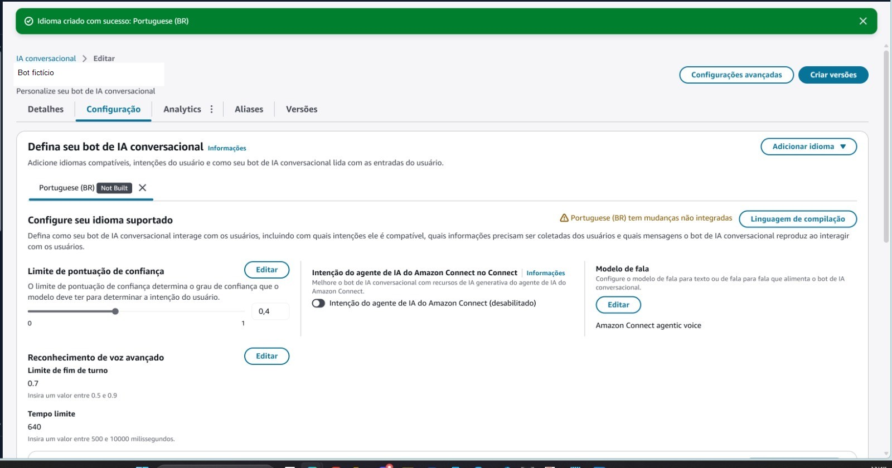

*Figura 1 — Visão de configuração do bot Lex e recursos associados ao projeto.*

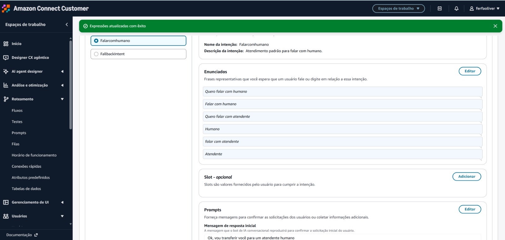

*Figura 2 — Intenções configuradas para organizar os tipos de solicitação reconhecidos pelo bot.*

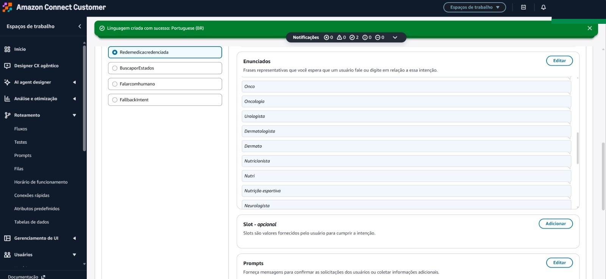

*Figura 3 — Edição de uma intenção e seus enunciados de exemplo.*

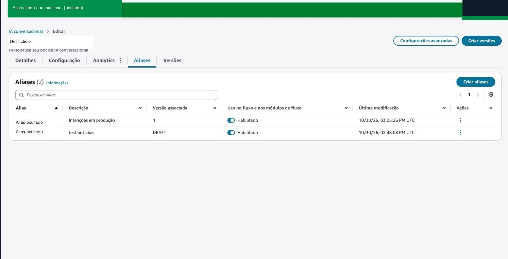

*Figura 4 — Aliases e versões do bot; nomes próprios foram ocultados.*

### 3. Cadastrar regiões e especialidades

Use os mesmos identificadores normalizados no Lex, na Lambda e no JSON. As regiões presentes na base são `centro`, `oeste`, `sul`, `norte`, `leste` e `abc_grande_sp`. “Nutrição esportiva” aparece como frase de exemplo e está associada à especialidade Nutrição.

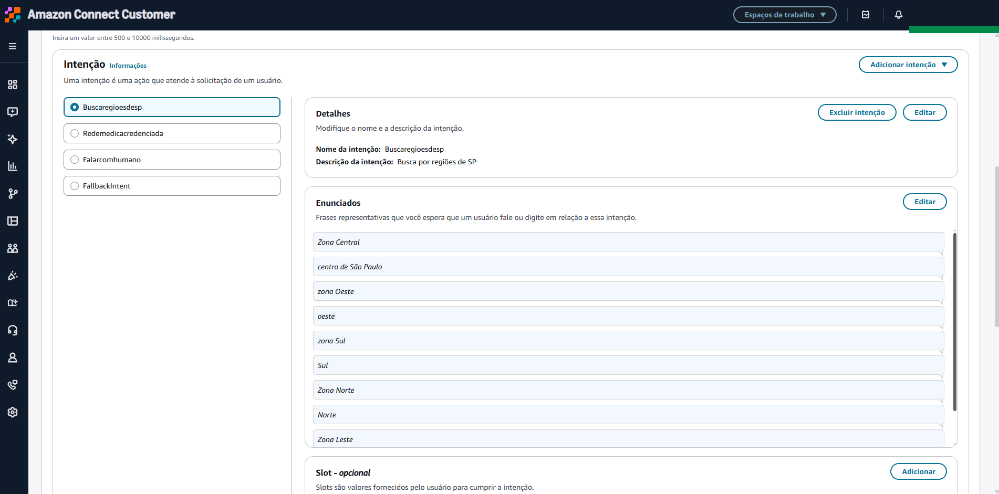

*Figura 5 — Exemplos de fala para localizar as regiões de São Paulo.*


*Figura 6 — Primeira parte da lista de especialidades configuradas na intenção de busca.*

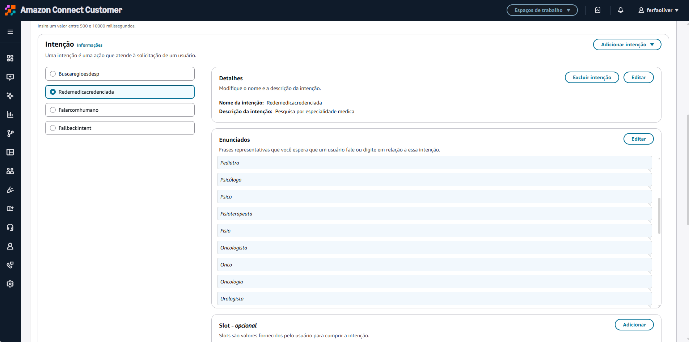

*Figura 7 — Continuação da lista de especialidades disponíveis para reconhecimento.*

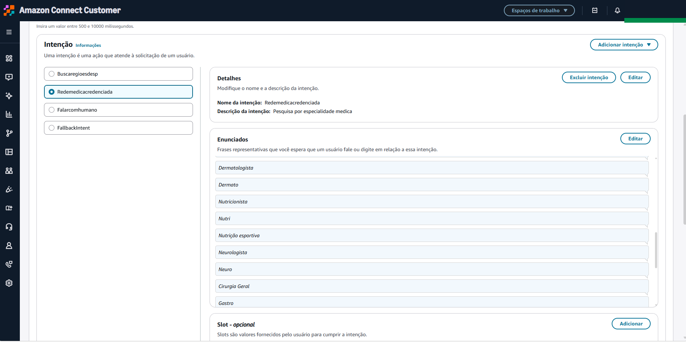

*Figura 8 — Mais exemplos de especialidades e termos equivalentes usados na intenção.*

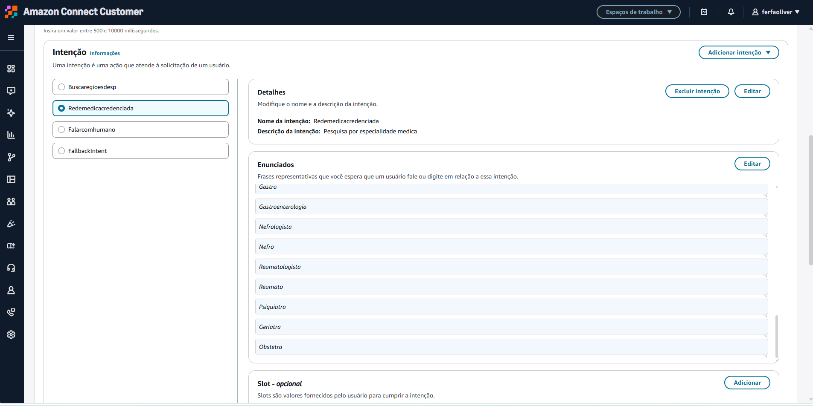

*Figura 9 — Parte final da relação de especialidades e seus enunciados.*

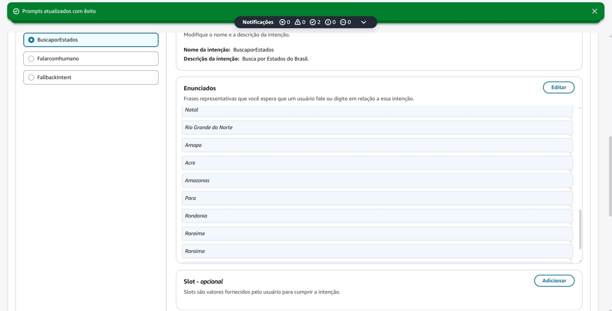

*Figura 10 — Visão das intenções e exemplos de enunciados cadastrados.*

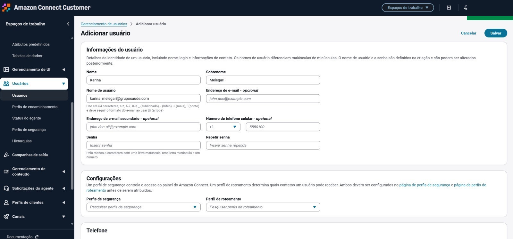

*Figura 11 — Formulário para adicionar uma intenção ao bot.*

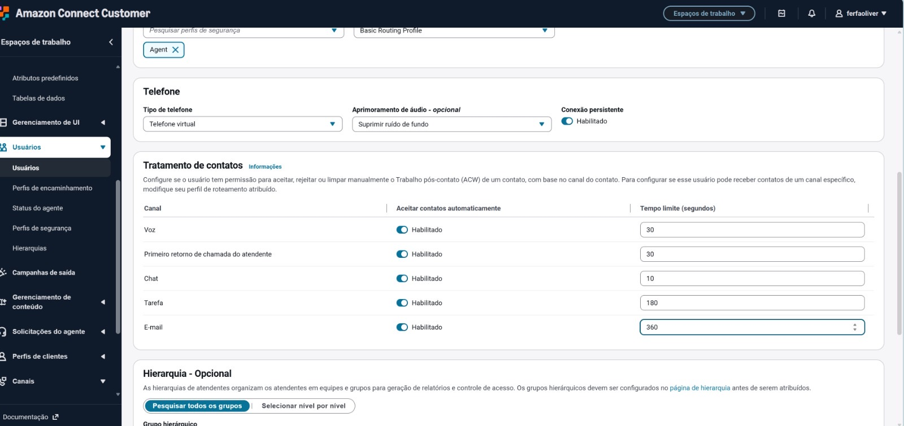

*Figura 12 — Campos de configuração usados para coletar e validar informações da conversa.*

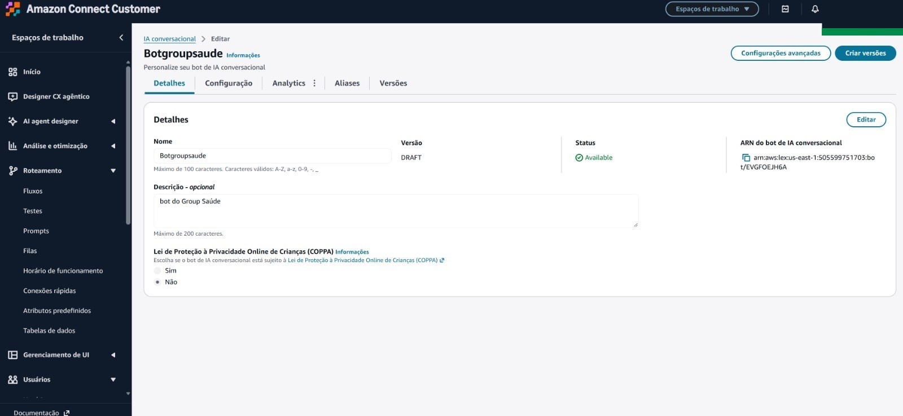

*Figura 13 — Visão geral do bot e de seus recursos configurados.*

### 4. Montar o fluxo de contato no Amazon Connect

No designer de fluxos, conecte a entrada da chamada à saudação, à coleta das informações e às decisões para busca ou atendimento humano. Trate caminhos de sucesso e erro, configure mensagens de retorno e encaminhe a chamada para a fila apropriada quando necessário.

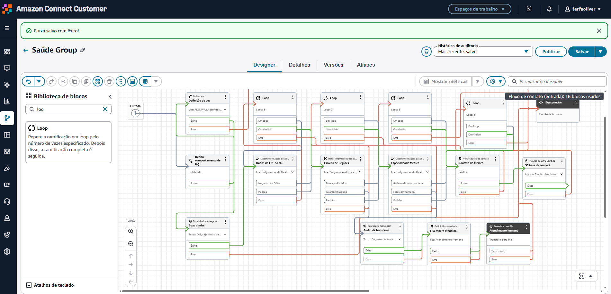

*Figura 14 — Visão do fluxo de entrada, com blocos de voz, coleta de informações, consulta e transferência.*

### 5. Configurar horários e filas de atendimento

Configure o horário de funcionamento e as filas de atendimento. Associe as filas às opções de roteamento e revise o destino de transferência e o tratamento para fila sem agentes disponíveis. A fila **Preferencial** faz parte da proposta humanizada; defina os critérios de elegibilidade e a prioridade operacional antes de ativá-la. Os nomes e as descrições específicos das filas foram ocultados nas imagens.

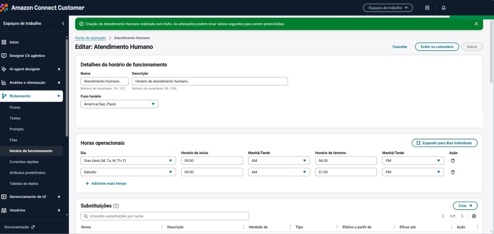

*Figura 15 — Horário de funcionamento e agenda da operação; o ARN foi ocultado.*

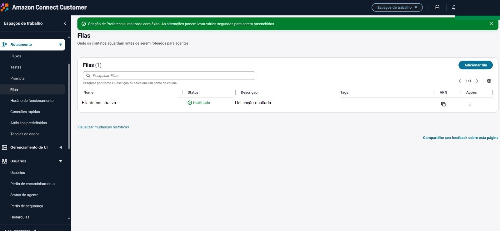

*Figura 16 — Lista de filas do Connect, com o nome e a descrição da fila ocultados.*

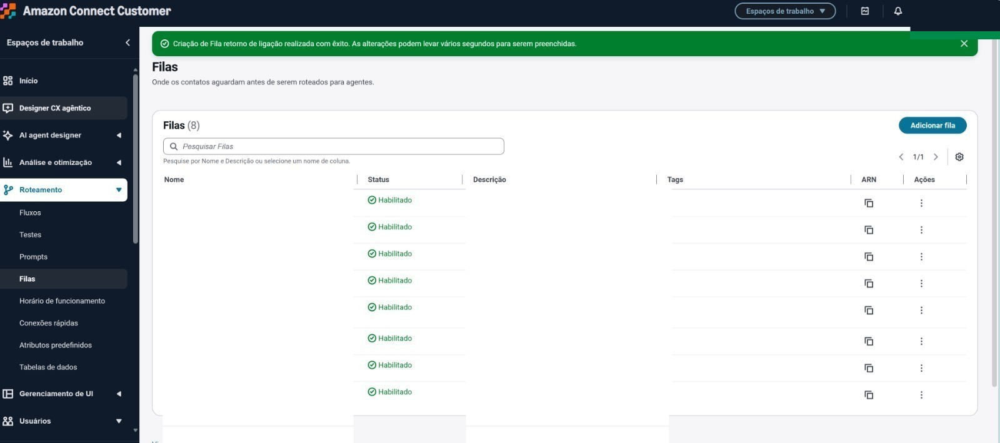

*Figura 17 — Visão das filas de atendimento; nomes e descrições específicos foram ocultados.*

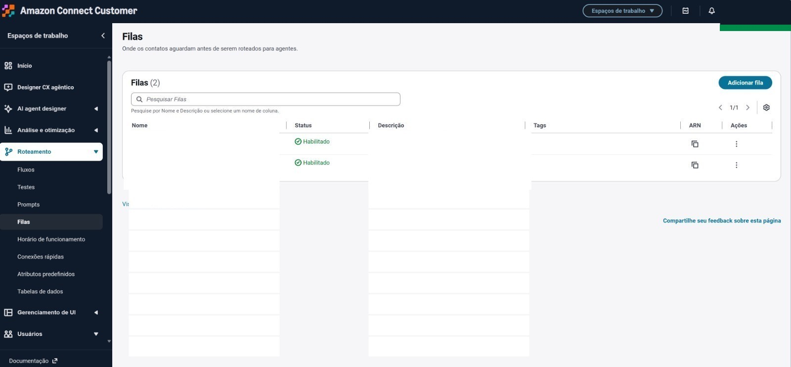

*Figura 18 — Filas básica e preferencial; dados de usuário foram ocultados.*

### 6. Criar o bucket e enviar a base fictícia ao Amazon S3

Crie um bucket privado na região AWS escolhida para o ambiente. A base de conhecimento usada neste exemplo é fictícia; envie o JSON e, se necessário, o CSV. Restrinja a leitura à função de integração que consulta os objetos.

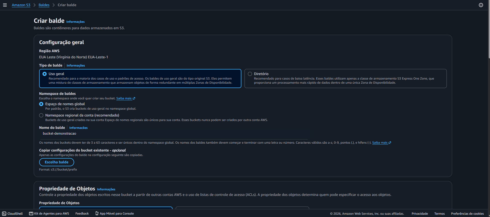

*Figura 19 — Criação de bucket S3; o nome específico foi substituído por um exemplo.*


*Figura 20 — Configurações de bloqueio de acesso público para manter o bucket privado.*


*Figura 21 — Opções de versionamento e tags durante a criação do bucket.*

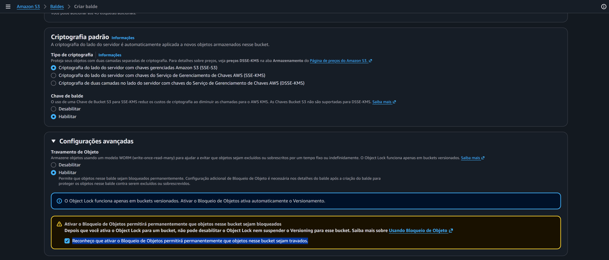

*Figura 22 — Opções de criptografia e bloqueio de objetos do S3.*

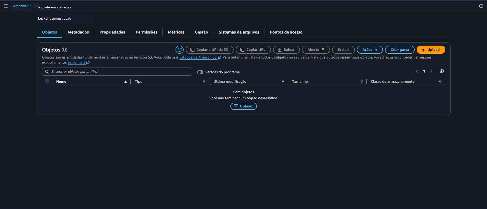

*Figura 23 — Visualização do bucket demonstrativo; o nome foi ocultado. A captura foi feita antes do envio do arquivo.*

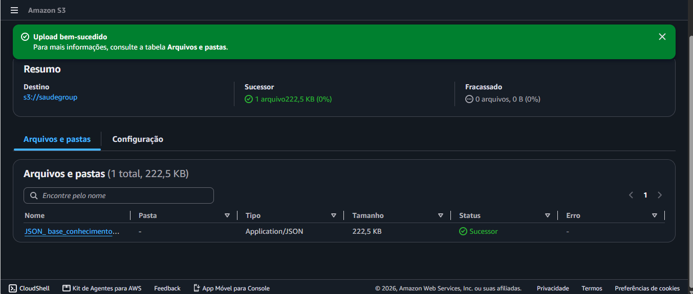

*Figura 24 — Upload bem-sucedido do JSON fictício. O nome do bucket foi substituído por um exemplo.*

### 7. Associar o bot ao Connect e integrar a consulta

Associe o bot publicado ao fluxo e confira se os IDs de região e especialidade correspondem aos do JSON. Para buscar os registros de forma determinística, implemente uma função AWS Lambda que receba esses IDs, leia o objeto JSON no S3, filtre os médicos pela combinação e devolva os campos necessários ao Connect. Conceda `s3:GetObject` somente ao objeto usado.

O fluxo mostrado inclui um bloco de função AWS Lambda, mas a captura indica que a função ainda não estava selecionada no bloco. A integração descrita aqui é o próximo passo de implementação, não uma afirmação de que a consulta já esteja operacional.

### 8. Validar o atendimento

Percorra cada ramo do fluxo: busca por região e especialidade, ausência de resultados, erro, fallback e transferência para atendimento humano. Teste as seis regiões, especialidades, diferentes maneiras cotidianas de pedir ajuda e as regras da fila Preferencial. Como próximo passo, configure e valide a análise conversacional/sentimento e acompanhe indicadores como resolução no autoatendimento, transferências, tempo de espera e satisfação.

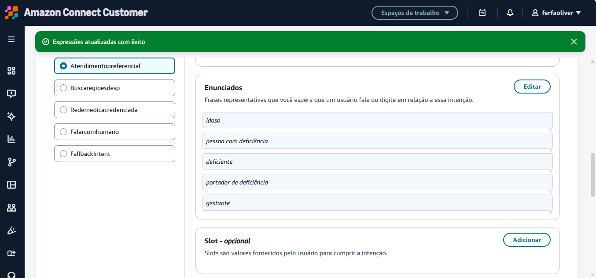

*Figura 25 — Intenção de atendimento humano e exemplos de enunciados.*

## Estrutura do repositório

```text
.
├── README.md
├── data/
│   ├── base_conhecimento_medicos_sp.json
│   └── medicos_rede_ficticia_sp.csv
└── docs/
    └── images/
        ├── 01-...jpg
        └── ...
```

## Observações

- O Amazon S3 armazena os arquivos; a lógica de filtragem precisa ser feita por uma integração, por exemplo uma função Lambda.
- A Knowledge Base do Amazon Connect/Bedrock é voltada à recuperação de conteúdo e respostas generativas. Para localizar registros estruturados de forma determinística, use uma consulta apropriada aos campos normalizados.
- As telas podem variar conforme a versão do console AWS e a região da conta.
- Antes de qualquer uso real, substitua os dados fictícios por informações autorizadas e confirme credenciamento, contatos e endereços com a fonte oficial.
